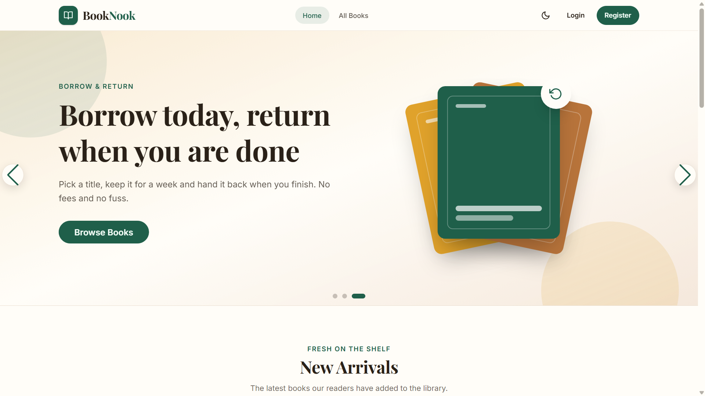
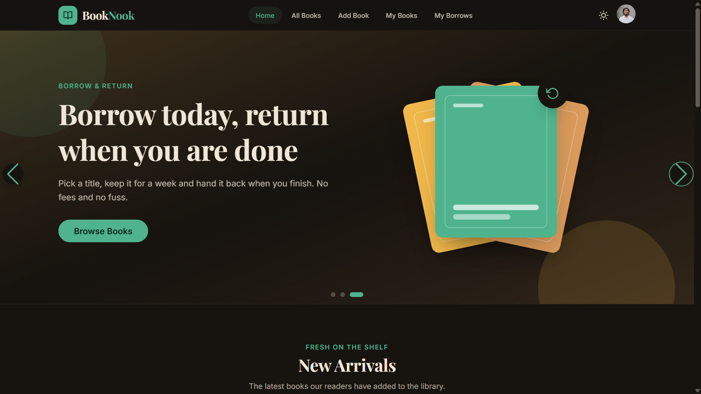

<div align="center">

# 📚 BookNook

**Add a book • Borrow a book • Return a book**

**Live URL :** https://booknook-jubumax.vercel.app

</div>

# Description

BookNook is a small online library. Readers put the books from their own shelves on the site, and other readers borrow them for a few days and hand them back when they are done.


<!-- Screenshots -->

[](https://booknook-jubumax.vercel.app)
[](https://booknook-jubumax.vercel.app)


<!-- Key Features -->

## Key Features

- **Browse every book** on the shelf, and filter by category (Fiction, Science, History, Kids, Others).
- **Add your own books** with a cover photo, a short description and the number of copies you have.
- **Borrow a book** with one confirmation. The number of available copies drops right away, and a book with no copies left shows "Not Available".
- **Return it** from the My Borrows page, which also shows how many days are left before the due date.
- **Manage your shelf.** Edit or delete the books you added from My Books.
- **Log in with email or Google**, and update your name and photo from your profile.
- **Switch between light and dark mode.** The site remembers your choice.
- **Use it on any screen.** The layout adapts from a phone to a wide desktop.


## Technologies Used

- **Next.js 16** (App Router, JavaScript) and **React 19**
- **Tailwind CSS 4** with **daisyUI** and custom light and dark themes
- **BetterAuth** for email and Google login, backed by **MongoDB**
- **Swiper** for the home page slider and **Motion** for scroll animations
- **react-hot-toast** for every success and error message
- **imgbb** for book cover uploads

The books and borrows live in a separate Express and MongoDB API, in the [booknook-server](https://github.com/jubumax/booknook-server-side) repo.


## Project Structure

```
src/
├── app/             pages and routes (App Router)
├── components/      layout, home, books, auth, profile and shared pieces
├── data/            static content for the home page and footer
├── hooks/           useAuth
├── lib/             auth, API helpers, validation, image upload
└── services/        calls to the books and borrows API
```


## Highlights

- **Loading and failure states everywhere.** Spinners while data loads, friendly messages when the API is down, and "Try again" buttons instead of blank screens.
- **No jumpy reloads.** While the app checks your login, you see a spinner, not a flash of the login page.
- **One form for adding and editing books.** Fewer bugs, and the same validation in both places.
- **Safe redirects.** The `?redirect=` after login only accepts paths on this site.
- **Accessible basics.** Keyboard focus is visible, icons have labels, modals trap focus, and animations switch off if your device asks for less motion.


<!-- ## What would be added next

- Search by title and author
- A reading list or favourites
- Email reminders for books that are due soon
- Automated tests for the borrow and return flow -->


## Getting Started

You need Node.js 20 or newer, a MongoDB database, and the API from the server repo running.

```bash
git clone https://github.com/jubumax/booknook-client-side.git
cd booknook-client-side
npm install
cp .env.example .env.local       # fill in your values
npm run dev
```

Open http://localhost:3000.

---

© 2026 BookNook — [@jubumax](https://www.linkedin.com/in/jubumax) • All rights reserved
